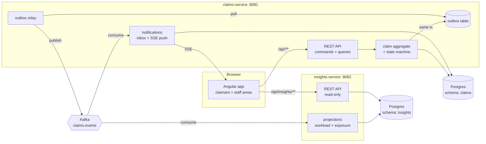
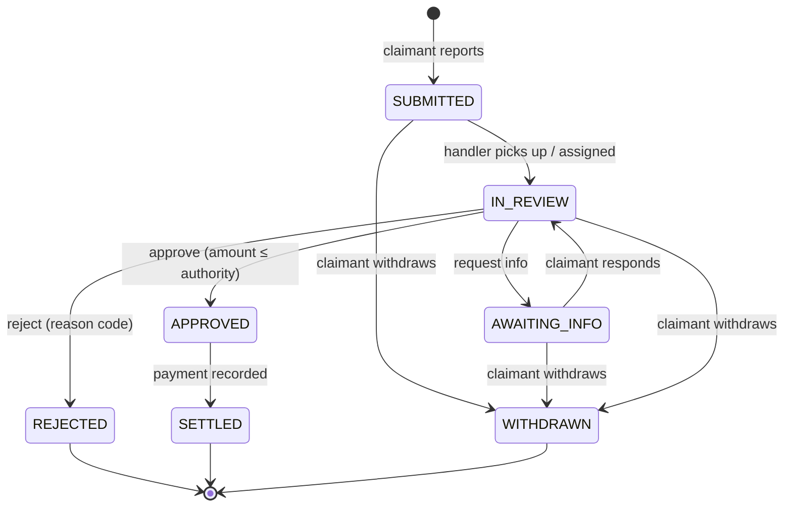
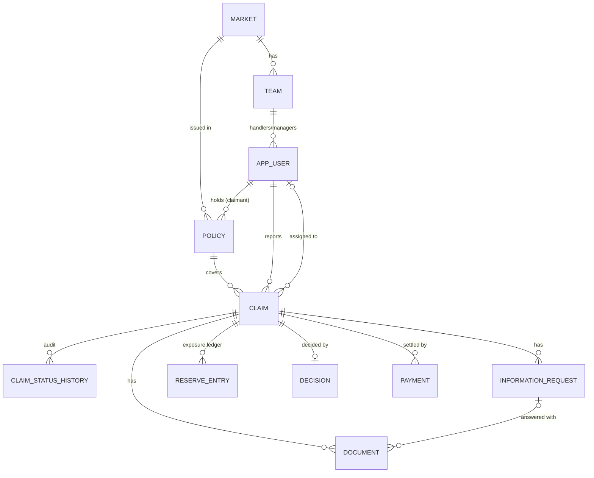

# Architecture & Design

This document explains how the claims platform is put together and, more importantly, why. I wrote the first version before any code existed, then kept it up to date as I built. Where the build ended up different from the plan, I've said so in the [decisions log](#decisions-log) at the end rather than quietly rewriting history.

If you only have five minutes, read sections 1 to 3. They cover the problem framing, the service split and the REST vs Kafka question, which are the decisions everything else follows from.

---

## 1. How I framed the problem

The brief describes three groups of people with three different problems:

- **Claimants** have no visibility. They phone or email, then wait.
- **Claims staff** work from shared inboxes and spreadsheets, with no single view of their workload.
- **Managers** have no live picture of outstanding claims or of how much money the company is likely to pay out.

So the platform has to do three things well: run the claim lifecycle reliably, keep everyone informed as things change, and give managers an accurate view of liability.

With a 2–3 hour target, I couldn't build everything, so I ranked the work:

1. The claim lifecycle on the backend, for both claimants and staff. This is the core, so it got the most care and the most tests.
2. Liability exposure, modelled properly rather than guessed from claimed amounts.
3. The event backbone that keeps notifications, live updates and dashboards in step with the lifecycle.
4. Workload views for staff.
5. A thin Angular frontend on top.

Things I knowingly left out: policy administration (policies are seeded), real payments, fraud checks, a real login provider, live exchange rates, document uploads, and multi-region concerns. Section 12 says what I'd do next.

---

## 2. One service or two?

I went with **two Spring Boot services that talk only through Kafka**.



**claims-service** is the system of record. It owns the claim, enforces every rule, and when someone clicks "approve" they wait for a yes or no. It needs to be strongly consistent.

**insights-service** answers questions like "how much liability is outstanding in Singapore motor?" and "who on the team is overloaded?". Those are heavy aggregate queries across all six markets, and it doesn't matter if the answer is a second behind.

That difference is what justifies the split. The two sides have different consistency needs and different load profiles, so it makes sense for them to scale and fail independently.

I'll be honest that my first instinct was a single service with internal modules. When I re-read the brief's question, *"What drives that decision?"*, I realised a single service would make Kafka hard to justify. Why put a message broker between two parts of the same process? With two services, Kafka has a real job, and you can watch it work.

I didn't split further into intake, assessment and settlement services. They all change the same claim, so splitting them would spread one claim across several databases, and I'd need sagas to keep them consistent. That's a lot of complexity for no benefit at this scale.

A boundary is only real if something enforces it, so a few rules hold here:

- claims-service never calls insights-service, and insights-service never writes claim data.
- Each service has its own Postgres schema *and its own database login*. The insights login gets "permission denied" if it tries to read the claims tables. For local convenience both schemas live in one Postgres instance; in production they'd be separate databases.
- The services share no Java code. The JSON event format is the contract between them.
- If insights goes down, claims carry on. When it comes back, it picks up from where it left off in Kafka. If its tables were ever lost, it could rebuild them by replaying the topic from the start.

Notifications live in claims-service rather than in a third service. They're aimed at claimants and need the same "can this person see this claim?" rules as everything else there. They still run off Kafka, though, so a notification problem can never block or roll back a claim decision.

---

## 3. What goes over REST and what goes over Kafka

My rule of thumb is simple: **if a person is waiting for the answer, it's REST. If it's a fact other parts of the system should react to, it's Kafka.**

So every action is a REST call: submitting a claim, picking it up, asking for information, answering, revising the reserve, approving, rejecting, settling, withdrawing. So is every screen of data. These need an immediate answer, including errors like "you can't approve a claim that's still waiting on the claimant" or "someone else just changed this claim".

Every change to a claim also produces an event on Kafka: `ClaimSubmitted`, `ClaimAssigned`, `InformationRequested`, `InformationProvided`, `ReserveChanged`, `ClaimApproved`, `ClaimRejected`, `ClaimSettled` and `ClaimWithdrawn`. Today three things listen: the insights projection, the notification inbox, and the live updates to the browser. Tomorrow a finance or fraud system could subscribe without anyone touching claims-service.

The browser never talks to Kafka directly.

### Not losing events: the outbox

The classic trap is to save the claim to the database and then send the event to Kafka as a second step. If the process dies between the two, you either lose the event or announce a change that never happened.

I avoided that with a **transactional outbox**. The claim change and its event are written to the database in the *same transaction*, so they succeed or fail together. A small relay then reads unsent events every half second, publishes them to Kafka, waits for Kafka to confirm, and marks them sent. It selects rows with `FOR UPDATE SKIP LOCKED`, so several instances could run the relay without double-sending.

The catch is that this gives "at least once" delivery. If the relay crashes after sending but before marking, the event goes out again. So every consumer ignores events it has already processed.

### What's in an event

Each event carries a **full snapshot** of the claim's reportable fields: status, market, product line, currency, team, handler, reserve, amount paid, deadline, and a version number. A small `data` section holds anything specific to that event, such as the question that was asked.

I chose snapshots over "just what changed" because it makes consumers simple and safe. Insights just stores the latest snapshot per claim and ignores anything with an older version number. That means a duplicate, a late arrival or a full replay can never corrupt the numbers. It also means insights never has to call back to claims-service to fill in gaps. The cost is somewhat bigger messages, which is a good trade at this scale.

All events go to one topic, `claims.events`, using the claim ID as the message key. Kafka only guarantees order within a partition, and keying by claim ID keeps all of one claim's events on the same partition, so they arrive in order.

### When things go wrong

- **Kafka down:** claims still work. Events wait in the outbox table, and the relay catches up when Kafka returns.
- **Insights down:** claims still work, and insights catches up from its saved position when it restarts. I tested this in Docker by stopping insights, approving a claim, and starting it again.
- **A bad message:** insights retries three times for temporary errors. After that, or straight away if the message is malformed, it moves the message to a dead-letter topic (`claims.events.insights.DLT`) so one bad message can't block everything behind it.
- **Notifications:** if one fails, I just log it and move on. Holding up the queue for a notification isn't worth it.

---

## 4. Handling "async" across the backend and the browser

Claims take days or weeks, and several people touch them. The way I've handled that:

- When you take an action, the response contains the claim's **new state straight away**, so your own screen is always right.
- Everything downstream (notifications, dashboards, the other person's screen) catches up within about a second.
- The browser keeps one open connection to the server using Server-Sent Events. When a claim you're allowed to see changes, the server sends a small "claim X changed" message, and the page re-fetches that claim over REST. The push is only a hint, so if one is missed you just see slightly stale data until the next refresh. You never see wrong data. I picked SSE over WebSockets because the traffic only flows one way, it's plain HTTP, and browsers reconnect automatically.
- One wrinkle: the browser's EventSource can't send an Authorization header, so the stream endpoint (and only that endpoint) also accepts the token as a query parameter.
- When a handler is waiting on the claimant, the claim sits in an explicit `AWAITING_INFO` state, and the decision deadline pauses so the handler isn't penalised for the claimant's delay.
- Two handlers picking up the same claim at the same moment is handled with optimistic locking. The second one gets a clear "already assigned" conflict instead of silently overwriting.
- Submitting a claim accepts an `Idempotency-Key`, so a double-click or a retry on a flaky connection can't create two claims.

---

## 5. The claim lifecycle



The allowed transitions live in one place, `ClaimStatus`, and they're unit-tested. Controllers never decide whether a move is legal.

Who is allowed to do what is decided in one class, `ClaimPermissions`:

- Claimants see only their own claims, handlers see their team's, and the manager sees everything.
- If you ask for a claim you're not allowed to see, you get a 404, not a 403. That way you can't use the API to discover whether a claim exists.
- Only the assigned handler (or the manager) can work a claim. Only the claimant can answer information requests or withdraw.

The same class works out the `allowedActions` list that comes back with every claim. The frontend just shows those buttons, so the rules can never drift apart between UI and server.

Handlers also have an **authority limit**. Priya, for example, can approve up to SGD 20,000. Above that the API refuses with `AUTHORITY_LIMIT_EXCEEDED`, and the manager has to approve it. The nicer version, where the claim gets routed to the manager's queue automatically, is on the next-steps list.

---

## 6. Liability exposure

This is the thing managers lack most today, so I modelled it properly rather than just adding up claimed amounts.

Every claim carries a **reserve**: the insurer's current best estimate of what it will actually pay. Changes to it are stored as an append-only ledger, so you can always see who changed it, when and why.

- When a claim comes in, the system sets an initial reserve of the claimed amount, capped at the sum insured, minus the deductible (and never below zero). For example, a claim of 6,800 on a policy with a 500 deductible starts at 6,300.
- As the handler learns more (a repair quote, say), they revise it and give a reason.
- Approving a claim sets the reserve to the approved amount.
- Paying it, rejecting it or withdrawing it releases the reserve to zero.

From that, two figures fall out naturally:

- **Outstanding liability** is the sum of reserves on claims that haven't been paid yet. That includes approved-but-unpaid claims, because the money is still owed.
- **Incurred** is what's been paid plus what's outstanding.

Six markets means six currencies, so I never add SGD to AUD. Every figure is reported per market, product line and currency. For a single headline number there's a USD equivalent using a fixed exchange-rate table, and the dashboard says clearly that it's illustrative. Money is always stored as an exact decimal, never as a floating-point number.

Claimants never see reserves. That's internal information.

---

## 7. Data model



The claim is the centre of everything. A claimant holds policies, makes a claim against one of them, and the claim is routed to the team for that policy's market. Around each claim sit its history, its information requests, its reserve ledger, its decision and its payments.

### claims-service tables (schema `claims`)

| Table | What it holds |
|---|---|
| `market` | The six markets (SG, HK, AU, MY, TH, ID) with currency and timezone. Seeded. |
| `team` | One claims team per market. |
| `app_user` | Everyone, with a role of CLAIMANT, HANDLER or MANAGER. Handlers have a team and an authority limit. |
| `policy` | Seeded policies: holder, product line, market, currency, sum insured, deductible and cover dates. |
| `claim` | The claim itself: status, amounts, assigned handler, team, priority, decision deadline, cached current reserve, and a version number for conflict detection. |
| `claim_status_history` | Every status change with who and why. This is the audit trail and the claimant's timeline. |
| `information_request` | Questions to the claimant and their answers. |
| `reserve_entry` | The append-only reserve ledger. |
| `decision` | One per claim: approved (with amount) or rejected (with reason code). |
| `payment` | Recorded settlements. Actually moving money is out of scope. |
| `document` | The table exists; uploads aren't built yet. |
| `outbox_event` | Events waiting to be published to Kafka. |
| `notification` | Each user's inbox, built from Kafka events. |
| `processed_event` | Event IDs already handled, used to skip duplicates. |

Motor and property claims need different details: a vehicle registration and injuries on one side, an address and the cause of damage on the other. I store these in a single JSON column on the claim rather than in separate tables. They're validated by typed request classes in the code, and they're never used to search across claims. The trade-off is that the database can't enforce them itself, so validation lives in the application.

The handler's queue is served straight from the `claim` table in claims-service, not from insights. When you're about to pick up a claim, you need up-to-date data, not data that might be a second behind.

### insights-service tables (schema `insights`)

| Table | What it holds |
|---|---|
| `claim_summary` | One row per claim, built from the event snapshots. Every workload, throughput and exposure figure is calculated from this table at query time. |
| `fx_rate` | Fixed exchange rates to USD for the headline number. |
| `processed_event` | Event IDs already handled. |

---

## 8. What each person sees

**Claimants** can report an incident against one of their policies (the form changes for motor or property), see all their claims with plain-language statuses like "Being reviewed" or "Action needed", answer questions when asked, and see the decision and payment. Notifications and live updates mean they don't have to keep refreshing.

**Handlers** get a queue sorted by decision deadline, with tabs for their own claims, unassigned claims, all open claims and closed ones. Claims past their deadline are highlighted, and urgent ones (injuries, or a home that isn't habitable) are flagged. A summary strip at the top shows open claims, claims waiting to be picked up, missed deadlines, and claims open over 30 days. Opening a claim shows its details, timeline, questions and answers, reserve history, and just the actions they're allowed to take.

**The manager** gets a dashboard with outstanding liability per market, product line and currency, a USD headline figure, the largest open reserves, and each handler's workload and throughput (decisions in the last 30 days and average days to decide).

---

## 9. The API contract

The backend owns the contract. I wrote the controllers first and let springdoc generate an OpenAPI spec from them. The specs are committed in `frontend/openapi/`, and the Angular client is generated from them with `ng-openapi-gen`. If the backend changes shape, the frontend fails to compile instead of breaking at runtime.

Generating the client turned out to be a useful check. It exposed two bugs in my spec that I'd never have spotted by reading code. The spec declared responses as `*/*`, so the generated client read every body as a binary blob. It also described paging as one object instead of `page`, `size` and `sort`. Both were fixed in the backend.

A few conventions run through the API:

- State changes are explicit actions like `POST /claims/{id}/approve`, not a generic "update status" call. Each action has its own validation and its own audit entry.
- Every action returns the claim's new state, including `allowedActions`.
- Errors come back in the standard problem+json format with a stable code (`INVALID_TRANSITION`, `VERSION_CONFLICT`, `AUTHORITY_LIMIT_EXCEEDED` and so on), so the frontend can react to them properly.

The main endpoints:

```
POST /api/auth/dev-login                   dev only: sign in as a seeded user
GET  /api/policies/mine                    claimant's policies
POST /api/claims                           report a claim (Idempotency-Key header)
GET  /api/claims                           list, filtered by status / assignedTo / market / line
GET  /api/claims/{id}                      detail + allowedActions
POST /api/claims/{id}/assign               pick up (handler) or assign (manager)
POST /api/claims/{id}/information-requests
POST /api/claims/{id}/information-requests/{requestId}/response
POST /api/claims/{id}/reserve | approve | reject | settle | withdraw
GET  /api/notifications
GET  /api/events/stream                    live updates (SSE)

GET  /api/insights/workload                insights-service
GET  /api/insights/throughput
GET  /api/insights/exposure                manager only
```

One gap I know about: springdoc marks every field as optional, so the generated TypeScript types are looser than they should be. That's an easy fix with `@Schema(requiredMode = REQUIRED)`.

---

## 10. Security

I kept this proportionate for a sprint, but real enough to be meaningful. There's no real login provider, so a dev-only endpoint lets you sign in as any seeded user, and a config property switches it off. It issues a signed JWT containing the user's ID, role and team. Both services validate the same token. Swapping in a real identity provider would mean pointing the token check at the provider's public keys; none of the authorisation code would change.

All the real authorisation happens on the server. The Angular route guards only keep people out of screens that wouldn't work for them anyway; they aren't a security boundary.

---

## 11. Technology choices

- **Spring Boot 3 on Java 17.** I chose Spring Boot over .NET, and Java 17 because that's the JDK on my machine; Boot 3 supports it fully.
- **PostgreSQL** for proper transactions around money and state, plus JSON support for the line-specific details.
- **Flyway** for schema migrations, with Hibernate set to *validate* only, so the code can never silently drift from the real schema. When I needed changes, I added new migrations rather than editing old ones.
- **Kafka** as a single node with no ZooKeeper, in Docker Compose.
- **No cache.** I had no measured need, and the insights service already takes the heavy reads.
- **insights-service uses plain JDBC, not JPA.** It's all upserts and aggregate SQL, so an ORM would only get in the way.
- **Testcontainers** for integration tests against real Postgres and Kafka, not mocks.
- **Angular 20** with standalone components and signals, lazy-loaded pages per role, and plain CSS rather than a component library, to save setup time.

---

## Decisions log

These are the decisions worth knowing about, including the ones that changed during the build.

1. **Spring Boot over .NET.** My call.
2. **Two services, not one.** The AI first suggested one service with modules. After re-reading the brief's "what drives that decision?" question, we switched to two, because that gives Kafka a real job.
3. **Initial reserve = claimed amount capped at sum insured, minus deductible.** Simple, explainable, and the handler refines it.
4. **No pre-aggregated exposure table.** I'd planned one, then dropped it. Keeping running totals right through every possible transition is error-prone, and calculating from `claim_summary` at query time is fast enough at this size, with a single source of truth.
5. **JDBC rather than JPA in insights-service**, for the reasons in section 11.
6. **A separate database login per service**, so the boundary is enforced by Postgres, not just by convention.
7. **Information-request answers are nested under the claim** in the URL, so every permission check starts by loading a claim the caller is allowed to see.
8. **Claimants never see reserves, deadlines or reserve history.**
9. **Events carry a full snapshot**, including the handler's name, so insights never needs to call back.
10. **The authority limit is a refusal for now.** Routing to the manager automatically is a next step.
11. **Paused claims don't count as missed deadlines in insights.** A small simplification: a claim that was already overdue when it was paused isn't counted until it resumes.
12. **Approved-but-unpaid claims count as outstanding liability**, because the money is still owed.
13. **Angular 20 via npx**, because the globally installed Angular CLI was too old for my Node version.
14. **Each browser tab has its own session**, so a claimant and a handler can be demoed side by side.

---

## 12. What I'd do next

In rough priority order:

1. **Document uploads.** The table is there; it needs an endpoint and proper file storage.
2. **Manager approval routing.** Above a handler's authority limit, the claim should land in the manager's queue rather than just being refused.
3. **A tighter contract.** Mark required fields in the spec, and add a CI check that the committed spec matches the running service.
4. **Real identity.** A customer login provider for claimants and the corporate one for staff.
5. **Operational basics:**
   - clean up old outbox rows
   - alert on relay lag
   - tooling to replay the dead-letter topic
   - trace IDs carried from the REST call through Kafka
   - live updates that work across several server instances
6. **More accurate deadline tracking** in insights, so a claim that was already overdue when it was paused still counts as overdue.
7. **Frontend tests**, starting with the claim action panel and one end-to-end happy path.
8. **Production data concerns:** separate databases per service, real exchange rates, and data-residency rules per market.
