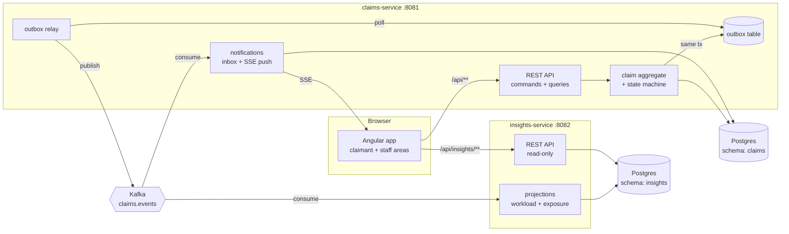
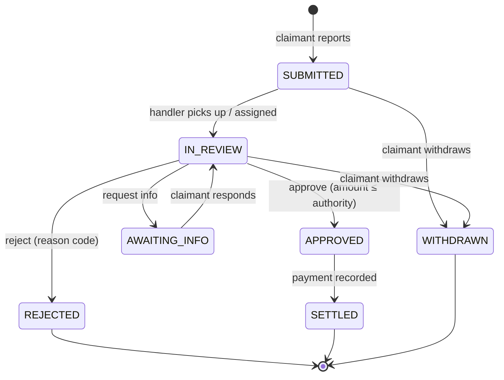
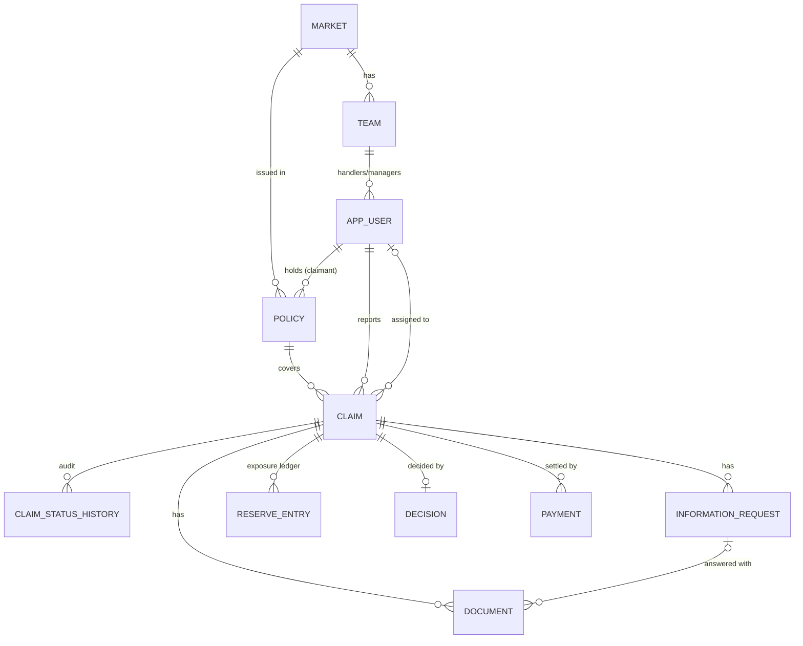

# Claims Platform — Architecture & Data Model (draft v1)

Status: **proposal for review** — nothing built yet. Each decision lists the alternative and why it lost, so it can be defended or overridden.

---

## 1. Scope for the sprint

**In (priority order)**
1. Claim lifecycle on the backend: submit → pick up → assess → request info ⇄ respond → approve/settle or reject.
2. Liability exposure: reserves per claim, outstanding exposure by market / line / currency.
3. Event backbone: domain events on Kafka driving notifications, live UI updates and the workload/exposure read models.
4. Staff workload views: my queue, team unassigned queue, ageing, SLA breaches, per-handler stats.
5. Angular app: claimant (report + track + respond) and staff (queue + claim detail + actions) — thin but working.

**Out (stated, not forgotten)**
Policy administration (policies are seeded), real payments, fraud scoring, real IdP/SSO, live FX rates, document OCR, i18n, multi-region deployment.

---

## 2. Service decomposition

**Decision: two Spring Boot services — `claims-service` (write side, system of record) and `insights-service` (read side, analytics) — connected only by Kafka.**



**What drives the split** — the two sides have different needs:

| | claims-service | insights-service |
|---|---|---|
| Job | System of record for claims | Workload and exposure analytics |
| Consistency | Strong. Validates every transition, and the user waits for the result | Eventual. A dashboard can lag by a second or so |
| Load | Small transactional writes | Aggregate reads across six markets |
| In | REST commands | Kafka events |
| Out | REST responses and Kafka events | Read-only REST |

**Rules that keep the boundary real**
- claims-service never calls insights-service, and insights-service never writes claim data.
- Each service owns its own schema, and neither reads the other's. Both schemas sit in one Postgres instance for local convenience; in production they would be separate databases.
- If insights is down, claims still flow. When it comes back, it catches up from its Kafka consumer offset, or rebuilds its tables from scratch by replaying the topic.
- Both services validate the same JWT (shared signing key locally; an IdP's public key in production).

**Why not split further** (intake / assessment / settlement services): those all change the *same* claim aggregate. Splitting them would spread one claim's state across databases and need sagas, for no benefit at one team's scale.

**Notifications stay in claims-service.** They are claimant-facing and need the same per-claim authorisation as claim reads. They still consume from Kafka, so a notification failure never rolls back a decision.

**Frontend routing:** locally, the Angular dev proxy sends `/api/insights/**` to `:8082` and everything else to `:8081`. In production this would be an API gateway (stated, not built).

---

## 3. REST vs Kafka

| Concern | Transport | Why |
|---|---|---|
| Submit claim, pick up, transition, request info, respond, set reserve, upload document | **REST (sync)** | A user is waiting for the result and needs validation errors immediately (invalid transition, version conflict). |
| Queries: my claims, queue, claim detail, dashboards | **REST (sync)** | Request/response reads. |
| Domain events (`ClaimSubmitted`, `ClaimAssigned`, `InformationRequested`, `InformationProvided`, `ReserveChanged`, `ClaimApproved`, `ClaimSettled`, `ClaimRejected`, `ClaimWithdrawn`) | **Kafka** | Facts that several consumers react to independently. They can be replayed to rebuild read models, and downstream systems (finance, fraud, a data lake) can subscribe without changing the claims service. |
| Workload/exposure read models | **Kafka → insights-service** | Moves aggregate reporting into a separate service with its own schema. Eventually consistent, which is acceptable for a dashboard. |
| Claimant/staff notifications + live UI refresh | **Kafka consumer → inbox table + SSE** | Notification failures must not roll back a claim decision. |

Rule of thumb: **commands and queries go over REST; facts go over Kafka.** The browser never talks to Kafka.

**Topic design:** a single `claims.events` topic, keyed by `claimId`. Kafka only guarantees order within a partition, and keying by claim puts all of a claim's events in one partition, so they stay in order. Event envelope: `eventId, eventType, claimId, occurredAt, version, actor, payload`. Consumers are idempotent: they record processed `eventId`s.

**Dual-write problem → transactional outbox.** The claim change and its event row are written in the same DB transaction, and a relay publishes outbox rows to Kafka. Without this, a crash between the DB commit and the Kafka send would lose events or publish events for changes that never happened. Delivery is at-least-once, which is why consumers must be idempotent.

---

## 4. Handling async across both tiers

- A command response returns the **new claim state synchronously**, so the UI never has to guess. The state change itself is strongly consistent.
- Side effects (dashboards, notifications) are **eventually consistent**, typically within a second.
- The frontend opens one **SSE stream** (`/api/events/stream`), filtered by user: a claimant gets their own claims, staff get their team's. A message means "claim X changed", and the UI refetches that claim. SSE rather than WebSockets because traffic is server→client only, it uses plain HTTP and it reconnects automatically. Fallback: polling.
- **Concurrency:** claims carry a `version` (optimistic locking). Two handlers picking up the same claim → the second gets `409 Conflict`.
- **Idempotent submission:** `POST /claims` accepts an `Idempotency-Key` header, so a retry after a flaky mobile connection does not create two claims.

---

## 5. Claim lifecycle



- Transitions live in **one state-machine class in the domain**, not in controllers, and every transition is unit-tested.
- The SLA clock is paused while `AWAITING_INFO`, so a handler is not penalised while waiting on the claimant.
- Stretch: an **authority limit** per handler; approvals above it go to `PENDING_APPROVAL` for a manager.

---

## 6. Liability exposure

Exposure is the core thing managers lack today, so it is modelled explicitly rather than derived from `claimedAmount`.

- **Reserve** = the insurer's current estimate of what it will pay on a claim. It is stored as an **append-only ledger** (`reserve_entry`), so every change has who, when and why. The current reserve is the latest entry.
- **Initial reserve** on submission = `min(claimedAmount, sumInsured) − deductible` (floored at 0). The handler revises it with a reason.
- **Outstanding liability** = sum of current reserves on non-terminal claims.
- **Approval** sets the reserve to the approved amount. **Settlement** records a payment and sets the reserve to 0. **Rejection/withdrawal** releases the reserve to 0.
- **Incurred** = paid + outstanding.
- **Multi-currency:** each claim is held in its policy's currency, and amounts are never summed across currencies. Dashboards show totals per currency, plus a converted reporting-currency (USD) total using a static `fx_rate` table, which is a stated simplification.
- Money is `decimal(19,2)` with a currency code (`BigDecimal`/`decimal`), never floating point.

---

## 7. Data model



### claims-service (schema `claims`)

| Table | Key columns | Notes |
|---|---|---|
| `market` | `code` (SG, HK, AU, MY, TH, ID), `name`, `currency`, `timezone` | Reference data, seeded. Six markets. |
| `app_user` | `id`, `role` (CLAIMANT / HANDLER / MANAGER), `name`, `email`, `team_id?`, `authority_limit?` | One user table with roles. Claimants and staff use the same app. |
| `team` | `id`, `name`, `market_code` | Workload is managed per team. |
| `policy` | `id`, `policy_number`, `holder_id`, `product_line` (MOTOR / PROPERTY), `market_code`, `currency`, `sum_insured`, `deductible`, `effective_from/to` | Seeded; a claim must fall within cover dates. |
| `claim` | `id` (UUID), `claim_number` (e.g. `SG-MOT-2026-000123`), `policy_id`, `claimant_id`, `product_line`, `market_code`, `currency`, `status`, `incident_date`, `reported_at`, `description`, `claimed_amount`, `details` (JSONB), `assigned_handler_id?`, `team_id`, `priority`, `sla_due_at`, `version`, timestamps | `product_line`/`market` are denormalised from the policy for filtering. |
| `claim_status_history` | `claim_id`, `from_status`, `to_status`, `actor_id`, `reason`, `occurred_at` | Written in the same transaction; this is the audit trail and the claimant's timeline. |
| `information_request` | `id`, `claim_id`, `requested_by`, `question`, `due_at`, `status` (OPEN / ANSWERED / CANCELLED), `response_text`, `responded_at` | Supports the "provide additional information" loop. |
| `document` | `id`, `claim_id`, `information_request_id?`, `uploaded_by`, `file_name`, `content_type`, `size_bytes`, `storage_key` | Files on local disk for the demo; production would use S3/Blob. |
| `reserve_entry` | `id`, `claim_id`, `amount`, `currency`, `reason`, `set_by`, `set_at` | Append-only exposure ledger. |
| `decision` | `claim_id` (PK), `outcome` (APPROVED / REJECTED), `approved_amount?`, `reason_code`, `notes`, `decided_by`, `decided_at` | One decision per claim. |
| `payment` | `id`, `claim_id`, `amount`, `currency`, `paid_at`, `reference` | Payments are recorded, not executed. |
| `outbox_event` | `id`, `aggregate_id`, `event_type`, `payload` (JSONB), `created_at`, `published_at?` | Transactional outbox. |

**Line-specific details as JSONB, not as subtype tables.** Motor details (vehicle registration, third party involved, injuries, police report number) and property details (address, peril type, whether it is habitable) differ, are validated by typed DTOs per line, and are not used in cross-claim queries. JSONB avoids sparse columns and table-per-subtype joins. Trade-off: weaker DB-level constraints, so validation sits in the application.

Also in claims-service, built from Kafka:

| Table | Purpose |
|---|---|
| `notification` | Claimant/staff inbox: `user_id`, `claim_id`, `type`, `message`, `read_at`. |
| `processed_event` | `consumer`, `event_id`, used for idempotency. |

Handler queues ("my queue", "team inbox") are served by claims-service directly from `claim`, because a handler acting on their queue needs up-to-date data, not a projection that may lag.

### insights-service (schema `insights`, built only from Kafka events)

| Table | Purpose |
|---|---|
| `claim_summary` | One row per claim: status, handler, team, market, line, currency, current reserve, paid, reported/decided timestamps, SLA due. The base for all aggregates. |
| `exposure_by_segment` | `market_code`, `product_line`, `currency` → open count, outstanding reserve, paid. Updated incrementally per event. |
| `fx_rate` | Static rates to USD for the reporting total. |
| `processed_event` | `event_id`, used for idempotency. |

Events therefore have to carry everything insights needs (market, line, currency, amounts, handler). Insights has no way to call back to claims-service for missing fields, and that is deliberate.

---

## 8. What the views show

**Claims handler**
- *My queue*: assigned claims sorted by SLA due date, with status, age, current reserve and an awaiting-info flag.
- *Team inbox*: unassigned claims, with one-click "pick up" (optimistic lock).
- Claim detail: timeline, documents, info requests, reserve history, actions valid for the current state (the server returns `allowedActions`).

**Manager**
- Open claims per handler, ageing buckets (0–7, 8–30, 30+ days), SLA breaches.
- Throughput: decided this week, average time to decision.
- **Outstanding exposure by market × line**, per currency, plus a USD total, with the largest open reserves listed.

**Claimant**
- Report an incident against one of their policies, with an incident-type-specific form.
- Their claims, each with a status timeline.
- Open information requests to answer, with uploads.
- The decision and settlement amount, plus notifications.

---

## 9. API contract

- **The backend owns the contract.** It is code-first: the OpenAPI spec is generated from annotations (springdoc / Swashbuckle) and **committed to the repo**. The Angular client is **generated** from that spec (`openapi-generator`), so drift breaks the frontend build instead of failing at runtime.
- The alternative, contract-first (writing the YAML by hand), is cleaner for teams in separate organisations but slower in a sprint where one person owns both tiers.
- Resource-oriented endpoints, with state transitions as explicit action sub-resources rather than generic `PATCH status`:

```
POST   /api/claims                              (claimant) submit
GET    /api/claims?mine | ?status&assignee&market&line
GET    /api/claims/{id}                         detail + allowedActions
POST   /api/claims/{id}/assign                  pick up / reassign
POST   /api/claims/{id}/information-requests
POST   /api/information-requests/{id}/response  (claimant)
POST   /api/claims/{id}/documents
POST   /api/claims/{id}/reserve
POST   /api/claims/{id}/approve | /reject | /settle | /withdraw
GET    /api/notifications
GET    /api/events/stream                       (SSE)

# insights-service (read-only)
GET    /api/insights/workload?teamId=           per-handler open counts, ageing, SLA breaches
GET    /api/insights/throughput?from&to         decided count, avg time to decision
GET    /api/insights/exposure?groupBy=market,line
```

Each service publishes its own OpenAPI spec, and the Angular client is generated from both.

- Errors use RFC 7807 `application/problem+json`, with stable error codes (`INVALID_TRANSITION`, `VERSION_CONFLICT`, `POLICY_NOT_IN_FORCE`).

---

## 10. Security (kept proportionate)

- Seeded users and a dev login endpoint that issues a JWT containing role, team and markets. No external IdP, which is a stated simplification.
- Authorisation is enforced on the server:
  - Claimants see only their own claims.
  - Handlers see only their team's market(s).
  - Only managers see exposure across all markets.
- Angular route guards are for UX only, never as the security boundary.

---

## 11. Technology

| Area | Choice | Reason |
|---|---|---|
| Backend | **Spring Boot 3 / Java 17** (decided) | Spring Web, Spring Data JPA, Spring Kafka, Spring Security (JWT), springdoc-openapi, Bean Validation. Maven. Java 17 because that is the JDK installed locally; Boot 3 supports it. |
| DB | PostgreSQL 16 | Relational integrity for money and state, plus JSONB for line details. |
| Migrations | Flyway | Versioned schema; Hibernate `ddl-auto=validate` so the entities can never silently drift from the schema. |
| Messaging | Kafka (single-node KRaft, in docker-compose) | Required. KRaft means no ZooKeeper. |
| Cache | **None** | No measured need. Read models already absorb dashboard load. Easy to justify leaving it out. |
| Tests | JUnit 5 + AssertJ + Testcontainers (Postgres, Kafka) | Integration tests run against real infrastructure, not mocks. The state machine has pure unit tests. |
| Frontend | Angular 18+, standalone components, signals, lazy-loaded `claimant` and `staff` feature areas, generated API client | One app with role-based areas, as the brief specifies. |
| Local run | `docker compose up` (Postgres, Kafka, claims-service, insights-service), `npm start` for the frontend | "Starts locally" in a single command. |
| Repo layout | `claims-service/`, `insights-service/`, `frontend/`, `docker-compose.yml`, `docs/` | One repo, so the commit history shows the whole process. |

---

## 12. Time plan (target ~3h, cap 5h)

| Block | Time | Output |
|---|---|---|
| Skeleton: repo, compose, migrations, seed data | 25m | Running infrastructure, seeded markets, policies and users |
| Claim aggregate, state machine, REST commands and queries, unit tests | 60m | Full lifecycle works over REST |
| Outbox, Kafka relay, notifications, SSE | 30m | Events flowing out of claims-service |
| insights-service: consumer, projections, workload/exposure endpoints, integration test | 45m | Second service built from events |
| Angular: claimant submit/track, staff queue, claim detail with actions | 60m | Thin end-to-end UI |
| Docs and journal tidy-up | 15m | README, this doc, AI journal |

If time runs short, cut from the bottom: the manager UI first, then SSE (fall back to polling). The backend lifecycle and exposure are never cut.

---

## 13. Decisions log
1. Backend stack → **Spring Boot 3 / Java 17**.
2. Service split → **two services (claims + insights)**. The AI first proposed a modular monolith, then changed its recommendation after looking at the brief's "what drives that decision" question; the user agreed.
3. Initial reserve = `min(claimed, sum insured) − deductible`, floored at 0 → **accepted**.
4. Authority limit / `PENDING_APPROVAL` → **stretch goal**.
